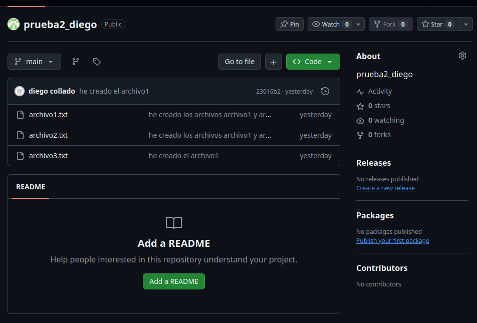
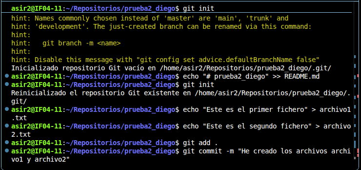
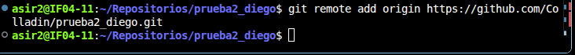
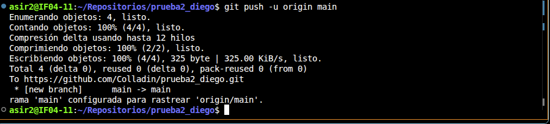

Vamos a crear un nuevo repositorio llamado prueba2_tu_nombre. Ten en cuenta lo siguiente:  

Para ello entraremos a Github y crearemos un nuevo repositorio, con poner el nombre que te piden vale, no hace falta crear el readme.md para que funcione. 

En esta ocasión, crea primero el repositorio local en Windows (usando git init). El repositorio debe contener, al menos, dos archivos de texto: archivo1.txt y archivo2.txt. El contenido de ambos archivos es libre. 

Lo primero que haremos sera utilizar el git init para iniciar el repositorio y despues con un echo crearemos dos archivos .txt que estaran dentro del repositorio. Para subirlos al repositorio utilizaremos los comandos git add . y git commit -m para confirmarlo.

Agrega (conecta) el repositorio local con un repositorio remoto en GitHub (usando git remote add). 

Para ello utilizaremos el comando git remote add origin y pondremos la dirección del del repositorio remoto.

Sube el repositorio local a GitHub (usando git push). 

Con el comando git push -u origin main podremos subir los cambios hechos anteriormente al repositorio.

