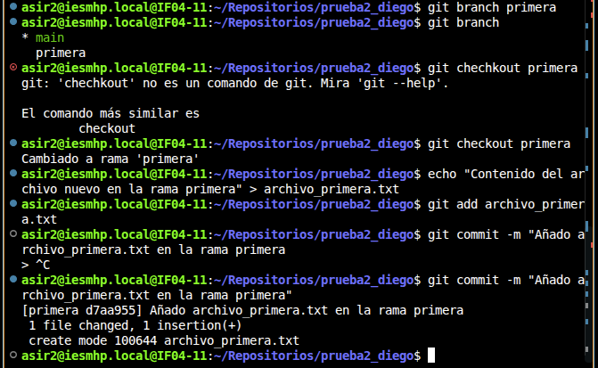
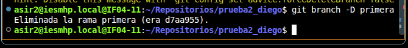
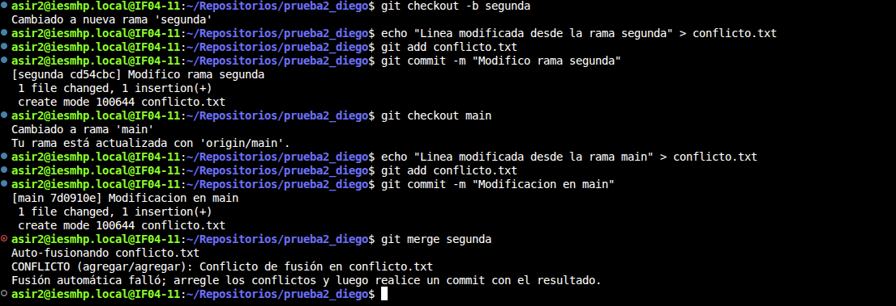

Creamos la rama Primera con el comando git branch y dentro de esa tama crearemos el archivo

Despues borraremos la rama recien creada con el comando git branch -D primera.

Despues haremos lo mismo con una rama nueva llamada segunda y veremos que salta un error.

