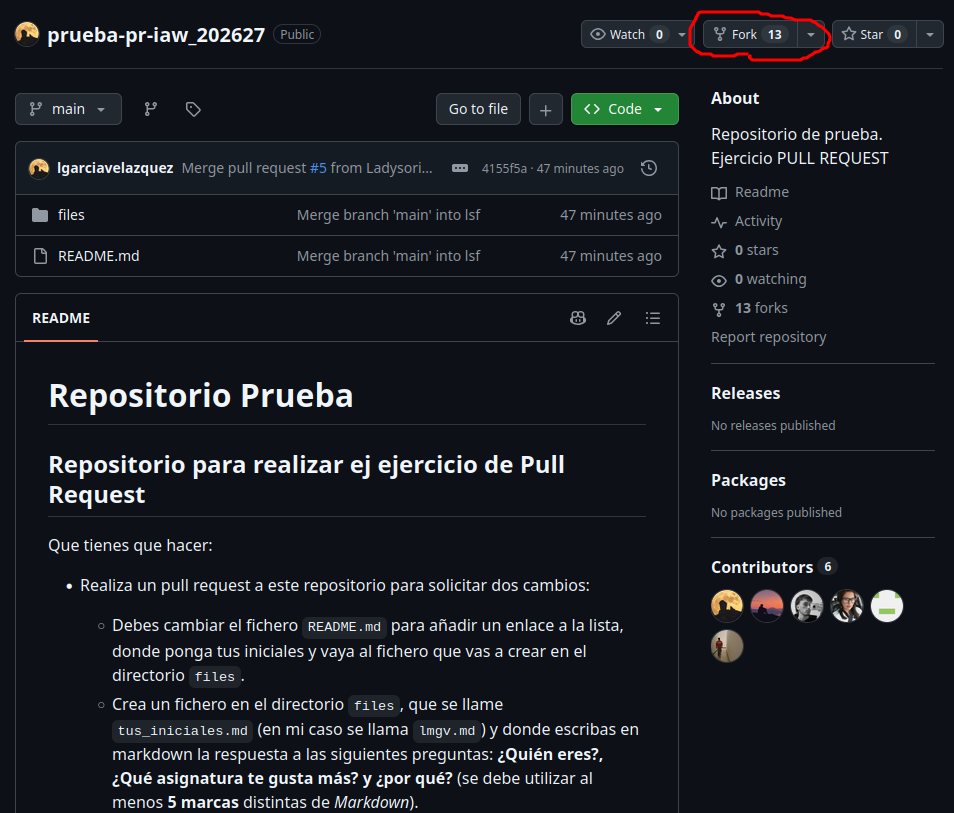
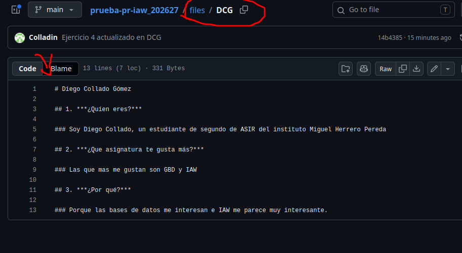
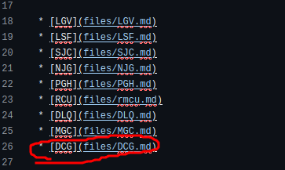
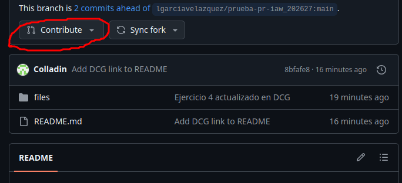

# Como hacer un pull request:

## Paso 1:
Lo primero sera entrar al link del repositorio del profesor. Despues le daremos a fork arriba a la derecha y creamos uno nuevo.

## Paso 2:

Despues de eso deberas crear un nuevo archivo en files con tus iniciales y dentro responder a las preguntas que te pide.

## Paso 3:

Despues haremos un commit para guardar los cambios e iremos al readme.md para editarlo y pondremos nuestro archivo.

## Paso 4:

Despues de eso guardaremos y volveremos a la pagina principal del repositorio y le daremos a contribute y haremos un pull request.

